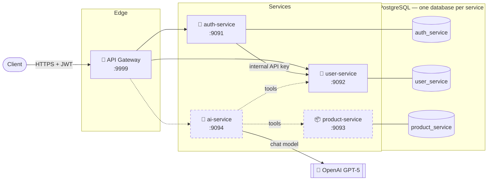

# 🛒 E-Commerce Microservices Platform


A distributed e-commerce backend built with **Java 21, Spring Boot 4 and Spring Cloud**. It is
split into independently deployable services behind an API gateway, secured with JWT, traced end
to end with OpenTelemetry, and now growing an **AI assistant built on LangChain4j** that answers
questions by calling the platform's own services.

> 🚧 **Actively developed, sprint by sprint.** Everything below marked ✅ runs today; anything else
> is labelled as scaffolded or planned.

---

## ✨ Highlights

- **Secure by design** — JWT access tokens plus rotating, revocable refresh tokens; role-based access
  control; tokens checked at the gateway *and* inside every service.
- **Reusable security starter** — a Spring Boot auto-configuration library: a new service adds one
  dependency and gets JWT validation for free.
- **Resilient service-to-service calls** — declarative HTTP clients, pooled connections, service
  discovery, and error mapping that separates retryable from non-retryable failures.
- **Observable** — every request is one trace in Jaeger, and every log line and response carries the
  trace id.
- **Automated delivery** — one Jenkins pipeline per service; a deploy only passes when the service
  reports healthy.
- **Cluster-safe scheduling** — background jobs run on exactly one instance, using ShedLock.
- **AI assistant (in progress)** — LangChain4j + OpenAI GPT-5, designed to call services as *tools*
  under the user's own permissions.

---

## 🏗️ Architecture



**Reading the diagram:** solid lines run today; dashed lines and boxes are scaffolded or in progress.
Not drawn, to keep it readable: every service registers with **Eureka** (`discovery-server`, :8761)
and exports traces to **Jaeger** (:16686).

**Key decisions**

| Decision | Why |
|---|---|
| **Database per service** | No shared tables or cross-service foreign keys — services link by id only, so each can change and deploy on its own |
| **Validate tokens twice** | The gateway rejects bad tokens early; each service validates again, so a request that bypasses the gateway is still protected |
| **Discovery over hard-coded hosts** | Services call each other by name (`lb://USER-SERVICE`) and Eureka resolves the instance |
| **AI is just another client** | `ai-service` reaches data only through service APIs and the user's JWT — never another service's database |

### How a login works

1. The client calls `POST /auth-service/api/v1/auth/login` on the **gateway**, which routes it to
   `auth-service` (login is a public endpoint).
2. `auth-service` asks `user-service` for the user's profile, roles and permissions over the
   **internal API**, authenticated with a shared key.
3. It checks the BCrypt password, revokes the user's old refresh tokens, and issues a new
   **access token** (1 h, with roles and permissions inside) and **refresh token** (7 d, stored in
   the database).
4. Later requests carry the access token. The gateway checks it, and the target service checks it
   again and authorizes **locally from the token's claims** — no extra network call.

---

## 🧩 Services

| Service | Port | Responsibility | Status |
|---|---|---|---|
| `gateway` | 9999 | Single entry point — routing, JWT check at the edge, trace id on responses | ✅ |
| `discovery-server` | 8761 | Eureka service registry | ✅ |
| `auth-service` | 9091 | Registration, login, JWT issuance, refresh-token rotation, token cleanup job | ✅ |
| `user-service` | 9092 | User profiles, roles, permissions, internal user lookup | ✅ |
| `utility-service` | — | Shared library: security auto-configuration, error contract, response envelope | ✅ |
| `product-service` | 9093 | Product catalogue | 🧱 Scaffolded |
| `ai-service` | 9094 | AI assistant — LangChain4j, tools, agents | 🚧 In progress |
| `config-server` | 8080 | Spring Cloud Config | 🧱 Scaffolded |

---

## ✅ Features

**Security**
- User registration with password confirmation and BCrypt hashing
- Login through Spring Security's `AuthenticationManager`, with user data looked up from `user-service`
- HS256 access tokens carrying `roles` and `permissions` claims
- Persisted refresh tokens with rotation on every refresh; login and logout revoke a user's tokens
- Refresh tokens are rejected anywhere an access token is expected
- Role-based access control (`users → roles → permissions`) with `@PreAuthorize`
- Internal service-to-service API on its own filter chain, guarded by a key compared in constant time

**Platform**
- Shared security starter — Spring Boot auto-configuration, every bean `@ConditionalOnMissingBean`
- Reactive API gateway (Spring Cloud Gateway on WebFlux) with Eureka-based load balancing
- Declarative HTTP clients (`@ImportHttpServices`) on a pooled Apache HttpClient 5 connection manager
- Stable machine-readable error codes (`AUTH_101`, `SEC-002`) and a uniform `ApiResponse<T>` envelope
- Flyway owns every schema (`ddl-auto=none`); JPA auditing and `@Version` optimistic locking
- OpenAPI / Swagger UI on the business services

**Operations**
- One Jenkins pipeline per service, triggered only by changes to that service's paths
- Health-gated deploys — the build fails unless `/actuator/health` reports `UP`
- Distributed tracing with OpenTelemetry → Jaeger, plus trace ids in every Log4j2 line
- Weekend refresh-token cleanup job, locked with ShedLock so it runs on one instance only

**AI assistant — foundation in place**
- Dedicated `ai-service`, registered in Eureka and part of the Maven build
- LangChain4j Spring Boot 4 starter with an OpenAI `gpt-5` chat model
- API key supplied by the `OPEN_AI_KEY` environment variable — never committed

---

## 🧰 Tech Stack

| Area | Technology |
|---|---|
| Language & framework | Java 21 · Spring Boot 4.1.0 · Spring Cloud 2025.1.2 |
| Edge & discovery | Spring Cloud Gateway (WebFlux) · Netflix Eureka · Spring Cloud LoadBalancer |
| Security | Spring Security · JJWT 0.13.0 · BCrypt |
| Data | PostgreSQL · Spring Data JPA / Hibernate · Flyway 12.4.0 |
| Mapping & docs | MapStruct 1.6.3 · Lombok · springdoc OpenAPI 3.0.2 |
| AI | LangChain4j 1.23.0-beta33 · OpenAI GPT-5 |
| Scheduling | Spring `@Scheduled` · ShedLock 7.10.1 |
| Observability | OpenTelemetry · Micrometer Tracing · Jaeger 2.20.0 · Log4j2 · Spring Boot Actuator |
| Build & delivery | Maven multi-module · Jenkins declarative pipelines |

---

## 🚀 Getting Started

**Prerequisites:** JDK 21 · Maven 3.9+ · PostgreSQL 14+ · Docker (optional, for Jaeger)

**1. Create the databases** — Flyway creates the tables on first start.

```bash
psql -U postgres -c 'CREATE DATABASE auth_service;' -c 'CREATE DATABASE user_service;' -c 'CREATE DATABASE product_service;'
```

**2. Build** — `install`, so the services can resolve the shared starter from your local repository.

```bash
mvn -f ecommerce-parent/pom.xml clean install
```

`discovery-server` is built on its own:

```bash
mvn -f discovery-server/pom.xml clean package
```

**3. Run the services in this order** — each one with `mvn spring-boot:run` from its folder. The
`local` profile (the default) points at `localhost:5432`.

| # | Service | Port | Why this order |
|---|---|---|---|
| 1 | `discovery-server` | 8761 | Everything else registers here |
| 2 | `user-service` | 9092 | `auth-service` calls it during login |
| 3 | `auth-service` | 9091 | |
| 4 | `gateway` | 9999 | Last, so routes resolve immediately |
| 5 | `ai-service` *(optional)* | 9094 | Needs `export OPEN_AI_KEY=sk-...` first |

**4. Try it**

```bash
curl -X POST http://localhost:9091/api/v1/auth/register -H "Content-Type: application/json" -d '{"email":"jane@example.com","firstName":"Jane","lastName":"Doe","displayName":"Jane","mobile":"9876543210","password":"Password123","confirmPassword":"Password123","gender":"FEMALE","dateOfBirth":"1990-01-15"}'
```

```bash
curl -X POST http://localhost:9091/api/v1/auth/login -H "Content-Type: application/json" -d '{"email":"jane@example.com","password":"Password123"}'
```

```json
{
  "success": true,
  "message": "Login successful. Welcome back!",
  "data": { "id": 1, "token": "eyJhbGci...", "refreshToken": "eyJhbGci..." }
}
```

Swagger UI: http://localhost:9091/swagger-ui.html · http://localhost:9092/swagger-ui.html

**5. See the trace (optional)**

```bash
docker run -d --name jaeger -p 16686:16686 -p 4318:4318 jaegertracing/jaeger:2.20.0
```

Repeat the login through the gateway, then open http://localhost:16686 — one trace across
gateway → auth-service → user-service.

---

## 📡 API Overview

Ports are the direct service ports. Through the gateway, prefix the path with `/auth-service` or
`/user-service`.

| Service | Method | Endpoint | Access | Purpose |
|---|---|---|---|---|
| auth | `POST` | `/api/v1/auth/register` | Public | Create credentials and profile |
| auth | `POST` | `/api/v1/auth/login` | Public | Issue access + refresh tokens |
| auth | `POST` | `/api/v1/auth/refresh-token` | Public | Rotate the refresh token, issue a new pair |
| auth | `POST` | `/api/v1/auth/logout` | Access + refresh token | Revoke the user's refresh tokens |
| user | `PUT` | `/api/v1/user/assign-role/{id}` | `ROLE_ADMIN` | Assign a role to a user |
| user | `POST` | `/api/v1/roles/add-role` | JWT | Create a role |
| user | `GET` | `/api/v1/roles/find-all-by-paginated` | JWT | Paginated roles (`page`, `size`, `sortBy`, `dir`) |
| user | `GET` | `/api/v1/internal/{email}` | API key | Profile with roles and permissions (service-to-service) |
| ai | — | *chat endpoint* | — | Planned — arrives with the first agent |

Errors share one shape, with a stable code clients can branch on:

```json
{ "status": 401, "errorCode": "SEC-002", "message": "JWT token expired", "path": "/api/v1/roles/find-all-by-paginated" }
```

---

## 📁 Project Structure

```
ecommerce-microservice/
├── ecommerce-parent/    Maven parent — dependency and plugin management (build from here)
├── utility-service/     Shared library: security starter + common contracts
├── discovery-server/    Eureka registry
├── gateway/             API gateway (reactive)
├── auth-service/        Credentials, JWT, refresh tokens, scheduled cleanup
├── user-service/        Profiles, roles, permissions
├── product-service/     Product catalogue (scaffolded)
├── ai-service/          AI assistant — LangChain4j
├── config-server/       Spring Cloud Config (scaffolded)
└── docs/                Deep-dive documentation
```

Each business service uses the same layers:

```
controller → service (interface) → service/impl → repositories → entity
                         ↕
                 dto ←→ mapper (MapStruct)
```

---

## 📚 Documentation

The README stays short; the details live in [`docs/`](docs):

| Guide | What it covers |
|---|---|
| [Security Model](docs/security.md) | Token claims, refresh-token design, the two credential types |
| [CI/CD — Jenkins](docs/ci-cd.md) | Per-service pipelines, path-scoped triggers, health-gated deploys |
| [Observability](docs/observability.md) | OpenTelemetry setup, trace ids in logs and responses, reactive pitfalls |
| [Scheduled Jobs — ShedLock](docs/scheduling.md) | How the distributed lock works, timing settings, gotchas |
| [AI Assistant — LangChain4j](docs/ai-assistant.md) | Tool calling, agents, memory, and the security design |

---

## 🎯 Engineering Practices

- **Shared route constants** — controllers and the HTTP clients that call them use the same path
  constants, so a renamed path is a compile error, not a 404.
- **Migrations own the schema** — Hibernate never alters a table; schema drift fails at startup.
- **Error codes, not error strings** — exceptions carry an `ErrorCode` (code, message, HTTP status).
- **Pipelines as code** — every service's `Jenkinsfile` sits beside its code and is reviewed like it.
- **Branching model** — `feature/* → dev → qa → stage → main`, one feature branch per ticket, merged
  by pull request after review.

---

## 🗺️ Roadmap

**Authentication** — ✅ registration · ✅ login · ✅ refresh rotation · ✅ RBAC · ✅ logout ·
⬜ email verification & password reset · ⬜ RS256 signing with JWKS

**AI assistant** — ✅ service + LangChain4j + OpenAI setup · ⬜ chat endpoint · ⬜ `@Tool` wrappers
over service APIs · ⬜ specialist agents + a router agent · ⬜ per-user conversation memory ·
⬜ gateway route · ⬜ RAG over the product catalogue · ⬜ guardrails and usage limits

**Platform hardening** — ✅ Jenkins CI/CD · ✅ health-gated deploys · ✅ ShedLock scheduling ·
⬜ integration tests with Testcontainers · ⬜ externalised secrets + Config Server ·
⬜ Resilience4j · ⬜ gateway rate limiting · ⬜ Docker Compose · ⬜ zero-downtime deploys

**Business services** — 🧱 product · ⬜ category & inventory · ⬜ cart, order, payment · ⬜ notification

**Scale & observability** — ✅ distributed tracing · ⬜ Kafka + transactional outbox · ⬜ Redis
caching · ⬜ Prometheus & Grafana · ⬜ centralised logging (ELK) · ⬜ Kubernetes on AWS

---

## 👨‍💻 Author

**Tarique Hayat** — Backend Engineer

Java · Spring Boot · Spring Cloud · Microservices · PostgreSQL · Spring Security · LangChain4j
