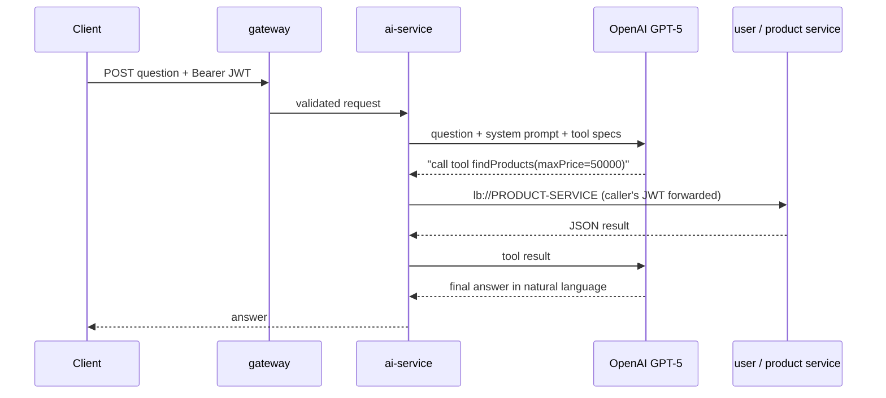

# 🤖 AI Assistant — LangChain4j

[← Back to README](../README.md)

A user should be able to ask *"what roles do I have?"* or *"show me laptops under ₹50,000"* in plain
language and get a correct answer drawn from live data. No single service can answer that — the data
is spread across `user-service`, `product-service` and, later, orders and inventory.

`ai-service` is the piece that bridges them. It takes the question, lets an LLM decide **which
microservice to call**, calls it through the normal service APIs, and turns the result into an
answer. The LLM never sees a database; it only sees the tools it is given.

> **Status:** the service, LangChain4j wiring, OpenAI model configuration and Eureka registration
> are in place. Tools, agents and memory below are the design being implemented — each is marked.

## How a question will flow

The LLM chooses *what* to call; `ai-service` is what actually calls it — under the user's own JWT.
That is the key safety property: the assistant can never see data the user could not have fetched
themselves.

## Building blocks

| Concept | LangChain4j feature | Role here | Status |
|---|---|---|---|
| **AI Service** | Declarative interface + `@SystemMessage` / `@UserMessage` | The assistant's contract — the system prompt and the method the controller calls | Planned |
| **Tools** | `@Tool`-annotated methods | Thin wrappers over the existing HTTP-interface clients (`lb://USER-SERVICE`, `lb://PRODUCT-SERVICE`) — the LLM picks one and fills in its arguments | Planned |
| **Agents** | Specialist AI Services, one per domain | e.g. an *account agent* (profile, roles) and a *catalogue agent* (products), each holding only its own tools | Planned |
| **Orchestration** | A router / supervisor agent | Classifies the question and hands it to the right specialist, or combines several | Planned |
| **Conversation context** | `ChatMemory` keyed by `@MemoryId` | Per-user message window so follow-ups like *"and the cheaper one?"* resolve | Planned |
| **Security context** | Caller's JWT forwarded on every tool call | Tools run with the user's permissions, enforced by the target service — not by the prompt | Planned |

## Design decisions

- **Tools call services, never databases.** The database-per-service rule holds for AI too, so every
  existing authorization check, validation and audit trail still applies.
- **Small agents over one big prompt.** Each agent sees only the tools for its domain, which keeps
  prompts short, tool choice accurate, and failures easy to isolate.
- **Permissions live in the services, not the prompt.** A prompt can be talked around; a `403` from
  `user-service` cannot.
- **Read-only tools first.** Write actions (placing an order, changing a profile) come later, behind
  explicit user confirmation.
- **Provider kept behind configuration.** The model is set by `langchain4j.open-ai.chat-model.*`, so
  switching model or provider is a configuration change, not a code change.

## Configuration

| Property | Value | Why |
|---|---|---|
| `spring.application.name` | `AI-SERVICE` | Eureka name — reachable as `lb://AI-SERVICE` |
| `server.port` | `9094` | |
| `langchain4j.open-ai.chat-model.api-key` | `${OPEN_AI_KEY}` | Supplied by the environment, never committed |
| `langchain4j.open-ai.chat-model.model-name` | `gpt-5` | |

