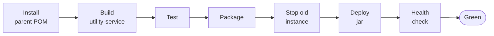

# 🔁 CI/CD — Jenkins

[← Back to README](../README.md)

Every service builds, deploys, and verifies itself. There is **one pipeline per module**, each
defined by a `Jenkinsfile` committed next to the code it builds — so the deployment process is
versioned, reviewed, and diffed like any other source file.

| Pipeline | What it deploys | Port | Profile |
|---|---|---|---|
| `discovery-server` | Eureka registry | 8761 | `dev` |
| `config-server` | Spring Cloud Config | 8888 | `native` |
| `auth-service` | Credentials, JWT issuance | 9091 | `dev` |
| `user-service` | Profiles, roles, permissions | 9092 | `dev` |
| `gateway` | Reactive edge | 9999 | `dev` |

## Change one service, redeploy one service

A GitHub webhook notifies Jenkins on every push, and each job subscribes to it through **GitHub hook
trigger for GITScm polling** in its own configuration. Each job is then **scoped to its own module
path**, so a commit that touches `auth-service`
rebuilds and redeploys `auth-service` alone — the other four instances keep serving traffic, never
restart, and never appear in the build history for that change.

Shared code is part of that scope. Three services also watch `utility-service` and
`ecommerce-parent`, because a change to the shared security starter or to dependency management
genuinely does affect what they ship:

| Job | Rebuilds when these paths change |
|---|---|
| `auth-service` | `auth-service/` · `utility-service/` · `ecommerce-parent/` |
| `user-service` | `user-service/` · `utility-service/` · `ecommerce-parent/` |
| `gateway` | `gateway/` · `utility-service/` · `ecommerce-parent/` |
| `discovery-server` | `discovery-server/` · `ecommerce-parent/` |
| `config-server` | `config-server/` |

That path filter is the job's *Included Regions* (Git plugin → **Additional Behaviours → Polling
ignores commits in certain paths**). Without it, one webhook would fan out into five simultaneous
redeploys of a system where four of them changed nothing.

## Pipeline stages



| Stage | What it does, and why it exists |
|---|---|
| **Install parent POM** | `mvn -N install` on `ecommerce-parent` — `-N` builds that POM only. The services resolve `utility-service` *from the local repository*, and reading its POM needs the parent there too, where `<relativePath>` no longer applies |
| **Build utility-service** | `install -DskipTests` — publishes the shared security starter so the service about to build can resolve it. Skipped by `discovery-server` and `config-server`, which don't depend on it |
| **Test** | `mvn clean test` — a failing test stops the pipeline before anything is deployed |
| **Package** | `mvn package -DskipTests`, reusing the tests that just ran |
| **Stop old instance** | `SIGTERM` first, so Spring Boot deregisters from Eureka and closes the DB pool cleanly; `SIGKILL` 15 s later for anything that ignored it, because a lingering process holds the port and the new instance cannot bind |
| **Deploy jar** | Starts the new jar under `JENKINS_NODE_COOKIE=dontKillMe`, which stops Jenkins from reaping the process when the build ends |
| **Health check** | Polls Actuator until the service reports `UP` — see below |

Each job also sets `disableConcurrentBuilds()` (two deploys of the same service must never race for
the same port) and `buildDiscarder` (keeps the last 15 builds).

## Deploys are gated on health, not on a sleep

The naive version of this — sleep 30 seconds, then check the process is alive — reports success for a
service that started, threw on a failed migration, and is answering nothing. **A live JVM is not a
working service.**

```groovy
sh 'curl -sf --retry 12 --retry-delay 5 --retry-connrefused http://localhost:$APP_PORT/actuator/health || { tail -n 100 /tmp/$MODULE.log; exit 1; }'
```

One command, covering every state a starting service passes through:

| While the service is… | Actuator answers | curl does |
|---|---|---|
| Still booting, port closed | connection refused | retries (`--retry-connrefused`) |
| Up, but a component is broken | `503` + `{"status":"DOWN"}` | retries — 503 is a transient error to curl |
| Ready | `200` + `{"status":"UP"}` | exits 0 — **stage passes** |
| Never ready | — | after 13 attempts over 60 s, `-f` exits non-zero, the last 100 log lines are printed, **build fails** |

Because Actuator's health aggregates its indicators, the gate is genuinely meaningful: for
`auth-service` and `user-service` it stays `DOWN` until Flyway has migrated and the PostgreSQL pool
is live; for `gateway` it reflects the Eureka client, so a gateway that cannot resolve `lb://` routes
never passes as healthy.

Only the health endpoint is exposed —
`management.endpoints.web.exposure.include=health` — and it is whitelisted in each service's
`SecurityConfig` so the pipeline can poll it without a JWT. No other actuator endpoint is reachable.


