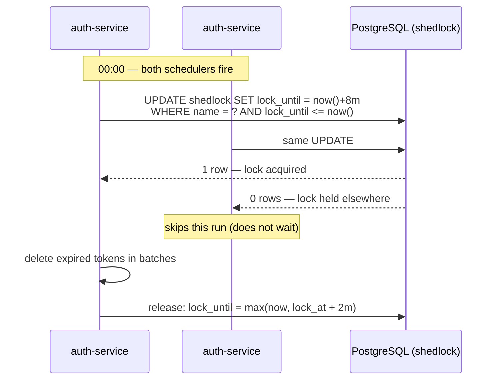

# ⏱️ Scheduled Jobs — ShedLock

[← Back to README](../README.md)

Refresh tokens are persisted, and every login, refresh and logout leaves revoked or expired rows
behind. Nothing ever read them again, but nothing removed them either — so `refresh_tokens` only
grew. `auth-service` now runs a scheduled cleanup that deletes them.

The catch is that `@Scheduled` has **no idea other instances exist**. Run two copies of
`auth-service` behind the load balancer and both fire at midnight, both scan the same rows, and both
try to delete them. For a cleanup job that is wasted work and lock contention; for a job that sends
emails or charges cards it would be a real defect. ShedLock fixes this with a lock row in the
service's own database.

## How the lock works



Acquiring the lock is a single conditional `UPDATE` (an `INSERT` the very first time). The database
guarantees only one instance can win it. The losers **skip** the run rather than queue behind it — the
next trigger is the next chance.

## Components

| Piece | Where | Role |
|---|---|---|
| `ShedLockConfig` | `auth-service/.../config/ShedLockConfig.java` | `@EnableScheduling` + `@EnableSchedulerLock`, and a `JdbcTemplateLockProvider` on the service's `DataSource` |
| `shedlock` table | `V2026.10.27.11.50__shedlock_schema.sql` | One row per lock name — created by Flyway like every other table |
| `ExpiredRefreshTokenCleanupJob` | `auth-service/.../job/ExpiredRefreshTokenCleanupJob.java` | The scheduled method, wrapped in `@SchedulerLock` |
| `TokenService.removeRefreshTokenByBatch` | `auth-service/.../service/impl/TokenServiceImpl.java` | Deletes revoked (`active = false`) or expired rows, one page at a time, until none are left |
| Dependencies | `ecommerce-parent/pom.xml` | `shedlock-spring` + `shedlock-provider-jdbc-template`, version pinned by `shedlock.version` |

```java
@Scheduled(cron = "0 0 0 * * Sat,Sun")
@SchedulerLock(name = "expiredRefreshTokenCleanup", lockAtMostFor = "8m", lockAtLeastFor = "2m")
public void cleanExpiredRefreshTokens() {
    tokenService.removeRefreshTokenByBatch(batchSize);
}
```

## Configuration

| Setting | Value | Why |
|---|---|---|
| `cron` | `0 0 0 * * Sat,Sun` | Midnight on Saturday and Sunday, in the server's time zone — low-traffic windows |
| `lockAtMostFor` | `8m` | Safety net: if the instance holding the lock dies mid-run, the lock expires on its own instead of blocking the job forever |
| `lockAtLeastFor` | `2m` | Keeps the lock even if the job finishes in milliseconds, so an instance whose trigger fires slightly late cannot start a second run |
| `defaultLockAtMostFor` | `10m` | Applies to any future `@SchedulerLock` that does not set its own |
| `usingDbTime()` | on | Lock timestamps come from PostgreSQL's clock, not each JVM's — clock drift between hosts cannot hand the lock to two instances |
| `expired.batch` | `100` (default) | Rows deleted per round trip; override in properties for larger tables |

> **The lock name is mandatory.** `@SchedulerLock` without `name` compiles and starts cleanly, but
> ShedLock throws `lock name can not be empty` every time the job fires — the job never runs and
> nothing fails at startup. The name is also the primary key in `shedlock`, so two jobs must never
> share one.

> **`lockAtMostFor` must be longer than the job.** If a run outlasts it, the lock expires while the
> job is still going and another instance can start the same work. Size it against the slowest
> realistic run, not the typical one.

## Not covered yet

- **Only `auth-service` schedules anything** — other services get the dependency through the parent POM but have no lock provider or `shedlock` table
- **No job metrics or alerting** — a run that fails or is skipped is visible only in the logs
- **Time zone is implicit** — the cron runs in the JVM's default zone; `@Scheduled(zone = ...)` would make it explicit
- **No tests** — lock acquisition across two instances is not covered by an integration test yet


